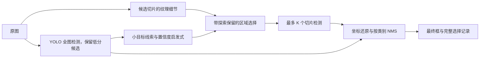

# ScaleScout

**让 YOLO 在有限计算预算下，决定哪些区域值得再看一次。**

ScaleScout 是一个小目标检测实验项目。它先对整张图运行 YOLOv8，再从候选区域中挑选少量局部图像放大检测。每次选择都保留理由、坐标、预算和最终检测结果，方便分析它究竟找回了什么，又增加了哪些误检。

本项目延续一个小组课程项目「基于 YOLOv8 的 COCO 数据集目标检测实践与性能分析」，将重点从模型介绍和结果展示推进到一个可检验的问题：

> 同样允许额外检测 K 个区域时，结合小目标检测线索、图像细节和区域覆盖，是否比均匀选择区域更有效？

切片检测、自适应切片都已有研究。这里的贡献定位是**可解释的预算调度实现与可复查实验**，不声称提出首创检测架构，也不预设一定优于已有方法。

## 快速开始

Python 3.10+。首次安装和下载模型需要联网，之后可以离线处理本地图片。

```bash
python -m venv .venv
# Windows PowerShell: .\.venv\Scripts\Activate.ps1
# Linux/macOS: source .venv/bin/activate
python -m pip install -e ".[yolo,dev]"
python -m pytest -q
scalescout your-image.jpg --budget 3 --device cpu --output outputs/example
```

输出 `trace.json` 和带框的 `detections.jpg`。模型首次使用会下载 `yolov8n.pt`，也可以通过 `--weights /path/to/weights.pt` 使用自己的权重。`--device 0` 使用第一张 CUDA 显卡。

本地直接打开 [演示面板](demo/index.html)，可以查看已运行实验的区域选择、检测框与预算；导入自己的 `trace.json` 和对应图片即可复查新结果。面板在浏览器中本地读取文件，不上传图片。**它是结果查看器，模型推理由 Python 执行。**

## 它如何工作



- **发现线索**：全图预测的较小、较低置信度目标给所在区域增加权重。
- **保留探索**：默认先用 `ceil(K × 0.25)` 个名额检查纹理较丰富的区域，让全图完全漏掉目标时仍有机会重新发现它。
- **减少重复**：区域之间的 IoU 产生惩罚，避免预算集中在高度重叠的区域。

后续名额的基础分数为 `0.7 × 归一化检测线索 + 0.3 × 归一化纹理细节`，再减去 `0.35 × 与已选区域的最大 IoU`。这些系数是初始启发式默认值，未通过本次评测集寻优。置信度不是经过校准的不确定性，纹理也不等于目标存在概率。

预算 `K` 指**额外切片数**，总调用数为 `1 + min(K, 候选数)`。所有切片使用同一输入分辨率。调用数是计算预算的代理指标，还需要看包含选择、预处理和合并的实际延迟。

## 实验与对照

仓库提供七种策略：

| 策略 | 用途 | 预算 |
|---|---|---|
| global | 原始全图检测 | 1 次 |
| uniform | 按中心距离分散覆盖区域 | 1+K 次 |
| random | 带固定随机种子的区域选择 | 1+K 次 |
| adaptive | 线索、纹理探索、重叠惩罚 | 1+K 次 |
| evidence | 仅检测线索，保留重叠惩罚 | 1+K 次 |
| texture | 仅纹理细节，保留重叠惩罚 | 1+K 次 |
| full | 检查全部候选切片 | 1+全部切片数 |

`full` 是自行实现的穷举切片参考，**不等同于 SAHI 软件包或其论文完整方法**。

```bash
# 获取 COCO val2017 中按 ID 排序的前 64 张有标签图片
python scripts/fetch_sample.py --root data --limit 64
python scripts/benchmark.py --images data/coco-mini/images \
  --labels data/coco-mini/labels --device cpu --limit 64 \
  --budget 3 --repeats 2 --output reports/my-run
```

Windows PowerShell 可以把以上 benchmark 命令写在一行。新报告会包含：

- 每张图的 TP、FP、FN 和小目标找回数。
- 固定阈值 precision / recall、小目标 recall、实际耗时和调用数。
- 每个策略的区域分数、选中顺序和预测框。
- 输入文件及模型的 SHA256、环境版本和可复现参数。
- 自适应与均匀策略的小目标召回差异及按图配对 bootstrap 区间。

已运行结果包括 [初始实验](reports/initial/RESULTS.md)、[边缘过滤后的复测](reports/refined/RESULTS.md) 和 [冻结参数后的另一批 64 图检查](reports/holdout/RESULTS.md)。原始计数、每张图的预测和环境版本均随报告保存。

每轮的 448 份逐图 JSON 记录保存在该目录的 `traces.zip` 中。运行 `python scripts/unpack_traces.py` 可校验哈希并恢复全部记录。汇总和 CSV 可以直接在线浏览。

另一批 64 图上，同样 4 次模型调用，均匀策略的小目标召回为 **33.90%**，自适应为 **36.44%**，仅线索为 **37.29%**。自适应整体 precision 为 62.33%，低于均匀策略的 64.59%；加入纹理探索尚未优于仅线索策略。原图检测只用 1 次调用，小目标召回为 20.34%。这体现了预算、召回与误检之间的取舍。

第一批图片上，内部切片边缘过滤把自适应策略的 FP 从 329 降为 140，同时 TP 从 273 降为 266。这项过滤基于初始结果提出，属于探索性优化。详细解读见 [结果分析](docs/FINDINGS.md)。

本次使用预训练 YOLOv8n 和总共 **128 张不同的验证图片**。报告中的固定阈值召回率**不是 COCO mAP/AP_small**，不能用于宣称刷新基准或证明通用性能优势。正式研究方案见 [实验协议](docs/EXPERIMENT_PROTOCOL.md)。

## 原课程项目的延续

原 PPT 展示 YOLOv8n 从零训练 300 epoch、较大预训练模型对比及 YOLO-World 提示词检测。当前只获得 PPT，没有原训练代码、权重、数据划分和日志，所以将历史结果与新实验分开记录。

- [原项目整理与技术校正](docs/COURSE_PROJECT.md)
- `scripts/train_baseline.py`：依据 PPT 重建的从零训练入口，**不是已验证的原实验复现**。
- `scripts/world_demo.py`：可选开放词汇演示入口，**未纳入本次运行验证**。YOLO-World 的附加依赖请参照官方说明。
- [方法与相关工作](docs/METHOD.md)：解释特色、已有方法和失败场景。
- [面试与答辩提纲](docs/PROJECT_STORY.md)：问题、实现、证据与下一步。

## 项目结构

```text
src/scalescout/      调度、几何、YOLO 接口、评测、命令行
scripts/            获取样本、评测、课程训练入口、YOLO-World 演示
tests/              坐标还原、预算、去重、一对一匹配等测试
demo/               离线结果查看器
reports/initial/    已运行结果与逐图证据
docs/               原作来源、研究定位、正式实验方案
```

## 许可与数据

本仓库代码使用 AGPL-3.0-or-later，见 [LICENSE](LICENSE)。Ultralytics 及其权重另受其上游许可约束。COCO 图片保留各自来源及许可，标注遵循 COCO 数据许可。本仓库不重新分发图片、模型权重或原 PPT。下载脚本保存来源和文件哈希。商业使用前请查看 [Ultralytics 许可](https://www.ultralytics.com/license) 和 [COCO 条款](https://cocodataset.org/#termsofuse)。

## 参考

- [Ultralytics YOLOv8](https://docs.ultralytics.com/models/yolov8/)
- [SAHI, 2022](https://arxiv.org/abs/2202.06934)
- [Adaptive Slicing-Aided Hyper Inference, 2023](https://www.mdpi.com/2072-4292/15/5/1249)
- [ROI-Gated SAHI, 2026 预印本](https://arxiv.org/abs/2608.23923)
- [YOLO-World](https://github.com/AILab-CVC/YOLO-World)

AI 协助完成当前代码和文档；原课程项目属于第 13 小组。当前仓库的训练入口、实验报告和贡献范围以对应文件中的标注为准。
